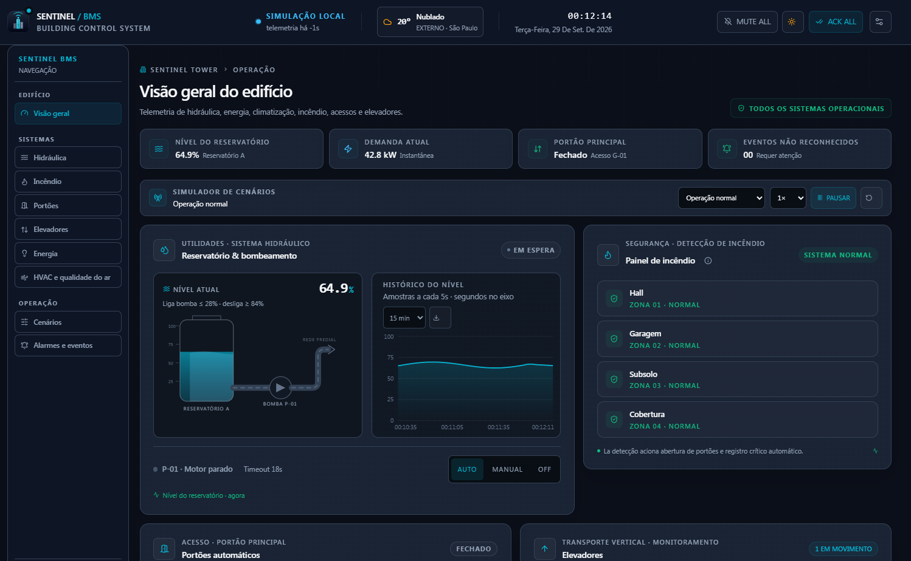
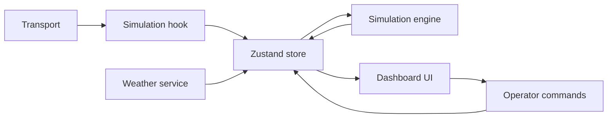

# 🏭 Sentinel BMS


[](https://github.com/alberto2santos/bms-dashboard/actions/workflows/ci.yml)

> **Dashboard BMS com visual SCADA para supervisão predial, simulação de equipamentos e gestão de alarmes.**

O **Sentinel BMS** é uma aplicação web de portfólio que simula uma planta predial no navegador. Reúne módulos de hidráulica, incêndio, portões, elevadores, iluminação, energia e climatização em uma interface responsiva com temas claro e escuro.

O projeto demonstra a integração entre uma interface operacional, estado global reativo e regras de simulação. A telemetria dos equipamentos é simulada; o clima externo consulta dados meteorológicos para a cidade escolhida.

## 📸 Prévia do dashboard



---

## 🚀 Recursos

### ⚙️ Operação e simulação

- **Sistema hidráulico:** nível do reservatório em SVG, fluxo animado, modos Auto/Manual/Off, setpoints de acionamento e parada e injeção de falha.
- **Painel de incêndio:** quatro zonas, reconhecimento de alarmes e interlock que abre os portões enquanto houver uma ocorrência ativa.
- **Portões automáticos:** comandos de abrir, fechar e parar, com aviso após cinco minutos em posição aberta.
- **Elevadores:** monitoramento simulado de andar, destino, direção, portas e ocupação; recall automático ao térreo com portas abertas durante incêndio.
- **Iluminação e energia:** circuitos por zona, agenda para luzes externas e demanda energética simulada.
- **HVAC:** modo de operação, setpoint e indicadores simulados de temperatura, umidade, CO₂ e ocupação.
- **Cenários de demonstração:** incêndio com interlocks, falha da bomba, portão travado, pico de demanda, nível baixo, pausa e velocidade da simulação.

### 🖥️ Interface e observabilidade

- **Alarmes:** quatro estados de ciclo (ativo, ativo ACK, normalizado pendente e normalizado ACK), shelving com motivo e prazo, auditoria de reconhecimento/normalização, filtros, exportação CSV e resumo de flood/ranking de fontes em 10 minutos.
- **Alertas sonoros:** sirene crítica sintetizada pela Web Audio API, com controle de mute.
- **Feedback de interface:** bipes discretos em ações de ACK e iluminação, silenciados pelo controle Mute All.
- **Microinterações:** retorno tátil visual nos comandos críticos e dicas contextuais nos painéis.
- **Tendências:** gráficos de nível de água e demanda energética com gradientes adaptados ao tema, seleção de período e exportação CSV.
- **Clima externo:** busca de cidades e exibição de temperatura, condição, sensação térmica, umidade e vento via [Open-Meteo Geocoding API](https://open-meteo.com/en/docs/geocoding-api) e [Weather API](https://open-meteo.com/en/docs).
- **Navegação lateral:** acesso às seções do dashboard, com seleção da seção ativa, entrada animada dos módulos e menu adaptado a telas menores.
- **Preferências locais:** tema, localização do clima, parâmetros, alarmes e outros dados selecionados são mantidos no navegador.

---

## 🏗️ Arquitetura

A aplicação separa a composição da interface, o estado global do Zustand e as regras da planta simulada. Os serviços de clima e transporte ficam isolados dos componentes visuais.



```text
.
├── src/
│   ├── app/
│   │   ├── globals.css              # Temas, animações e responsividade
│   │   ├── layout.tsx               # Layout raiz e metadados
│   │   └── page.tsx                 # Entrada da aplicação
│   ├── components/
│   │   ├── charts/
│   │   │   ├── EnergyTrendChart.tsx # Histórico de demanda energética
│   │   │   └── WaterTrendChart.tsx  # Histórico do nível do reservatório
│   │   └── dashboard/
│   │       ├── BmsDashboard.tsx     # Composição do dashboard
│   │       ├── ElevatorPanel.tsx    # Posição, direção, portas e ocupação
│   │       ├── EventLog.tsx         # Alarmes, filtros, ACK e exportação
│   │       ├── FirePanel.tsx        # Zonas de incêndio e interlock
│   │       ├── GatePanel.tsx        # Portões, comandos e temporizador
│   │       ├── HeaderBar.tsx        # Relógio, conexão e ações globais
│   │       ├── HvacPanel.tsx        # Climatização e qualidade do ar
│   │       ├── HydraulicPanel.tsx   # Tanque SVG, bomba e tendência
│   │       ├── InfoTooltip.tsx      # Dicas contextuais de operação
│   │       ├── LightingPanel.tsx    # Circuitos e consumo
│   │       ├── PanelHeading.tsx     # Cabeçalho reutilizável de painéis
│   │       ├── SensorFreshness.tsx  # Atualidade da telemetria
│   │       ├── SettingsModal.tsx    # Setpoints, agenda e injeção de falhas
│   │       ├── SidebarNavigation.tsx # Navegação dos módulos
│   │       └── WeatherWidget.tsx   # Seleção de local e condições atuais
│   ├── hooks/
│   │   ├── useBmsSimulation.ts     # Ciclo da simulação e sirene
│   │   └── useWeather.ts           # Atualização periódica do clima
│   ├── services/
│   │   ├── alarmUtils.ts           # Retenção, flood e frequência por fonte
│   │   ├── alarmLifecycle.ts       # Ciclo ISA e prazos de shelving
│   │   ├── bmsContracts.ts         # Contratos Zod versionados
│   │   ├── bmsSimulationEngine.ts  # Regras dos equipamentos simulados
│   │   ├── bmsTransport.ts         # Interface de transporte e mock
│   │   ├── elevatorStateMachine.ts # Transições e recall dos elevadores
│   │   ├── gateStateMachine.ts     # Transições e guards do portão
│   │   ├── pumpStateMachine.ts     # Modos, operação e falhas da bomba
│   │   └── weatherService.ts       # Geocodificação e consulta meteorológica
│   ├── store/
│   │   └── useBmsStore.ts          # Estado global e persistência
│   └── utils/
│       ├── audioAlert.ts           # Alarme sintetizado pela Web Audio API
│       ├── exportCsv.ts            # Exportação de dados para CSV
│       └── trendRange.ts           # Intervalos dos gráficos
├── infra/
│   ├── mosquitto/                  # Configuração local do broker
│   └── postgres/init/              # Schema inicial do historiador
├── ml/
│   ├── app.py                      # Treino e inferência Isolation Forest
│   └── requirements.txt            # Dependências do serviço Python
└── services/
    └── mqtt-collector.ts           # Validação e persistência MQTT
```

### Stack

- **Next.js 16** com App Router e **React 19**
- **TypeScript 5**
- **Tailwind CSS 4**
- **Zustand 5** para estado e persistência local
- **Zod 4** para contratos versionados de telemetria, comandos e eventos
- **Framer Motion 13** para transições suaves entre módulos
- **Recharts 3** para gráficos
- **Lucide React** para ícones
- **Open-Meteo** para geocodificação e dados meteorológicos

---

## 🚦 Como executar

**Pré-requisito:** Node.js 20.9 ou superior.

Na pasta do projeto, instale as dependências e inicie o servidor:

```bash
npm install
npm run dev
```

Abra [http://localhost:3000](http://localhost:3000). O primeiro gesto na página habilita a reprodução de áudio no navegador.

Para gerar a versão de produção:

```bash
npm run build
npm run start
```

Para validar alterações localmente:

```bash
npm run lint
npx tsc --noEmit
npm test
```

### Stack local de MQTT e historiador

O modo padrão do dashboard continua usando simulação local. Para iniciar PostgreSQL, Mosquitto, coletor MQTT, API Next.js e serviço de ML:

```powershell
Copy-Item .env.example .env
```

Altere `POSTGRES_PASSWORD` e `SERVICE_API_TOKEN` no `.env` antes de iniciar. Os serviços e portas são limitados a `127.0.0.1` para desenvolvimento local.

```bash
docker compose up --build
```

A interface ficará em `http://localhost:3001`. O broker recebe telemetria em `sentinel/{deviceId}/telemetry` e eventos em `sentinel/{deviceId}/alarms`; o coletor descarta payloads inválidos e persiste mensagens válidas no PostgreSQL. A migração inicial cria as tabelas ao subir um volume novo.

As rotas `GET /api/telemetry` e `GET /api/events` exigem `Authorization: Bearer <SERVICE_API_TOKEN>`. A rota `POST /api/ml/train` treina um Isolation Forest com telemetria persistida e requer ao menos 100 amostras. Depois do treino, `POST /api/ml/predict` valida e encaminha a telemetria para a inferência online. O modelo fica no volume `ml_models`.

O broker local permite acesso anônimo apenas para desenvolvimento e não deve ser exposto à internet. Para produção, configure autenticação/TLS do MQTT, credenciais gerenciadas do PostgreSQL, token forte e um serviço Node de longa duração para o coletor; a Vercel hospeda a interface/API, não o subscriber MQTT contínuo.

---

## 🌦️ Dados meteorológicos

O local inicial é São Paulo. Use o widget no cabeçalho para pesquisar uma cidade; o Sentinel consulta as condições atuais nas coordenadas selecionadas e repete a consulta a cada 15 minutos. A documentação do Open-Meteo informa que as condições atuais são baseadas em dados de modelo meteorológico em intervalos de 15 minutos. Portanto, esse dado é uma referência meteorológica para o local, não uma leitura de estação instalada no edifício.

O widget requer conexão com a internet. Se a consulta falhar, o painel sinaliza a indisponibilidade e não inventa uma temperatura.

---

## 🚧 Limites da simulação

- O transporte ativo é `MockBmsTransport`; não há conexão com PLC físico, broker MQTT ou serviço de backend configurado.
- Bombas, portões, elevadores, incêndio, energia e HVAC usam dados simulados para demonstrar a interface e as regras de operação.
- O interlock de incêndio libera os portões e inicia o recall dos elevadores ao térreo. As cabines permanecem com as portas abertas até a normalização de todas as zonas.
- A simulação e a agenda autônoma executam no navegador e param quando a página deixa de rodar.
- Eventos e preferências são armazenados localmente no navegador; não há historiador central nem sincronização entre operadores.

---

## 🗺️ Roadmap

- [x] Implementar testes automatizados para interlocks, alarmes e máquinas de estado dos equipamentos.
- [x] Adicionar recall de emergência dos elevadores e definir seu comportamento em cenários de incêndio.
- [x] Modelar as transições do portão e o ciclo de vida dos alarmes como máquinas explícitas.
- [x] Modelar os estados e transições de bombas e elevadores como máquinas explícitas.
- [x] Usar timestamps de telemetria como referência temporal da simulação e cobrir invariantes com testes de propriedade.
- [x] Definir contratos Zod para telemetria, comandos e eventos.
- [x] Implementar o coletor MQTT validado por contrato e configurar o broker local.
- [x] Adicionar Docker e Docker Compose para desenvolvimento local com os serviços necessários.
- [x] Integrar endpoints protegidos e PostgreSQL para persistir telemetria e eventos.
- [ ] Adicionar autenticação, perfis de operador e trilha de auditoria no backend.
- [x] Treinar e servir um modelo inicial de detecção de anomalias usando dados persistidos.
- [ ] Avaliar o modelo com dados operacionais rotulados antes de uso em decisões de segurança.

---

## 👤 Autor

Alberto Luiz

[GitHub · @alberto2santos](https://github.com/alberto2santos) · [alberto.dos.santos93@gmail.com](mailto:alberto.dos.santos93@gmail.com)
